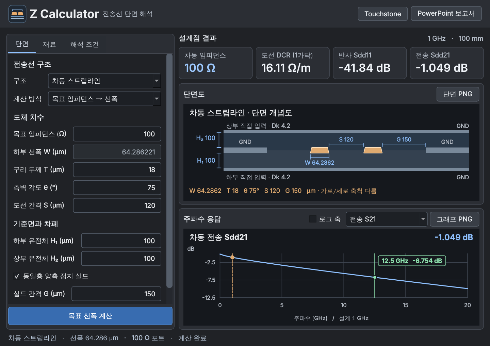

# Z Calculator

PCB 전송선의 단면 치수로 특성 임피던스와 손실을 계산하는 Windows 데스크톱 앱. 목표 임피던스에서 도선 하부 선폭을 역산하고, 같은 조건으로 다시 해석한 결과를 표시한다.

**[Windows x64 설치 파일 다운로드](https://github.com/yunhyok/z-calculator/releases/latest)** · 기본 설치 폴더 `C:\Program Files\Z Calculator`. 설치 화면에서 다른 드라이브와 폴더 선택 가능.



## 01 / 사용 순서

1. **단면**에서 마이크로스트립, 스트립라인, 차동 마이크로스트립, 차동 스트립라인 중 하나를 선택할 것. 도선 하부 선폭, 두께, 접지면까지의 거리 입력. 차동쌍은 도선 사이 간격도 입력. 구조와 치수를 바꾸면 오른쪽 **단면도**가 계산 전에도 바로 따라 바뀐다.
2. **재료**에서 상대 유전율 Dk와 손실 탄젠트 Df를 직접 입력하거나, 로컬 Cadence 재료 라이브러리(`.cmx`)를 열고 유전체 선택. 라이브러리 재료를 고르면 설계 주파수의 Dk·Df가 입력란에 채워지고, 그 값을 고치면 직접 입력으로 바뀐다. 앱이 마지막 라이브러리 경로를 기억한다.
3. **해석 조건**에서 주파수 범위, 설계 주파수, 선로 길이, 양단 포트 임피던스 설정.
4. **임피던스 계산** 또는 **목표 선폭 계산** 실행(Ctrl+Enter). 차동 구조의 목표와 포트 임피던스는 차동값. 역산 시 간격·두께·측벽 각도·접지 실드 간격은 고정. 입력을 바꾸면 다시 계산할 때까지 결과에 "이전 계산 결과" 표시가 붙는다.
5. **주파수 응답** 목록에서 그래프 선택 후 **그래프 PNG**. S11·S21·전파 손실은 선형 주파수 축, 임피던스는 로그 축이 기본이며 **로그 축**으로 그래프마다 바꿀 수 있다. 그래프를 클릭하거나 끌면 그 주파수의 값을 읽는 마커가 놓이고, 오른쪽 클릭으로 지운다. 마커는 PNG와 보고서에도 들어간다. **단면 PNG**는 치수선이 포함된 단면 개념도 저장. **PowerPoint 보고서**는 조건·재료·단면·전체 그래프·대표 수치·모델 가정을 담은 `.pptx` 생성.
6. **Touchstone**은 계산한 S파라미터를 저장한다. 단일 선로는 2포트 `.s2p`, 차동쌍은 단일 종단 4포트 `.s4p`. 4포트는 저장 전에 포트 번호 배치를 그림으로 보여 주며 묻는다. 파일을 읽을 도구에서 차동쌍으로 묶을 포트와 같은 배치를 고를 것.

## 02 / 단면과 재료

| 입력 | 정의 |
| --- | --- |
| W / T | 도선 하부 선폭 / 구리 두께. 길이 단위 µm |
| 측벽 각도 θ | 기판 면 기준 45°–90°. 기본 90°. 상부 선폭 = W − 2T / tan θ |
| H₁ / H₂ | 구리 하부에서 아래 접지면까지 / 구리 상부에서 위 접지면까지 거리 |
| S / G | 차동쌍의 하부 가장자리 간격 / 바깥 도선과 동일층 접지 실드 사이 하부 간격 |
| 마이크로스트립 | 하부 유전체와 접지면, 상부 공기. 솔더마스크 없는 노출 도선 |
| 스트립라인 | 상·하부 접지면. 양측 유전체와 높이를 독립 지정. 도선 옆의 재료 경계는 구리 두께 중앙 |
| 접지 실드 | 신호선과 같은 층에 놓인 양측 접지 도체. 실드의 접지 연결은 이상적으로 모델링 |

CMX 라이브러리는 사용자 PC에서 읽는다. 주파수 표는 로그 주파수에서 Dk·Df를 보간하고, 범위 밖은 가장 가까운 끝값을 사용한다. 단일 기준점과 직접 입력은 주파수 전체에 상수로 적용한다. 온도 표기가 없는 기본 모델을 우선 사용하며, 온도별 모델만 있을 때는 25 °C에 가장 가까운 모델을 선택한다.

## 03 / 결과 해석

| 결과 | 단위 | 의미 |
| --- | --- | --- |
| 특성 임피던스 | Ω | 손실을 포함한 복소 특성 임피던스의 실수부 Re(Zc). 차동쌍은 2 × Zodd |
| 단위 길이당 DCR | Ω/m | 20 °C 구리 도선 한 가닥의 단면적 기준 직류 저항. 주파수에 대해 일정 |
| 반사 S11 | dB | 지정한 길이의 균일 선로를 동일한 두 실수 기준 임피던스에 연결한 20 log₁₀ abs(S11). 0 dB 이하이며 작을수록 반사가 작음. 차동쌍은 Sdd11 |
| 단위 길이당 전파 손실 | dB/m | 전파 상수 실수부의 감쇠. 정합된 선로의 단위 길이당 손실. 양수 |
| 전송 S21 | dB | 20 log₁₀ abs(S21). 0 dB 이하이며 선로 길이와 양단 불정합 포함. 차동쌍은 Sdd21 |

반사 손실(RL)과 삽입 손실(IL)은 정의상 양수인 손실값이고, 같은 양을 S파라미터로 그리면 부호가 반대다(RL = −S11 dB, IL = −S21 dB). 1.2.0부터 측정기와 같은 S11·S21 표기로 통일했다. [Bird, Definition and Misuse of Return Loss](https://doi.org/10.1109/MAP.2009.5162049)

Touchstone 파일은 `# Hz S RI R <기준 임피던스>` 형식이다. `.s2p`는 포트 1이 근단, 포트 2가 원단. `.s4p`의 각 포트 기준 임피던스는 차동 기준의 절반(차동 100 Ω이면 50 Ω)이며 번호 배치는 두 가지 중 고른다. 선택한 배치와 차동쌍으로 묶을 포트는 파일 머리 주석에 적힌다.

| 배치 | 근단 쌍 | 원단 쌍 | 선로 + | 선로 − | 맞는 경우 |
| --- | --- | --- | --- | --- | --- |
| 근단 1·2, 원단 3·4 (기본) | 포트 1, 2 | 포트 3, 4 | 1 → 3 | 2 → 4 | 왼쪽에 1·2, 오른쪽에 3·4가 있는 회로 도구의 4포트 기호 |
| 근단 1·3, 원단 2·4 | 포트 1, 3 | 포트 2, 4 | 1 → 2 | 3 → 4 | 선로마다 번호가 이어지는 채널 모델 |

<strong>배치가 읽는 쪽과 다르면 차동 전송(Sdd21) 자리에 누화가 표시된다.</strong> 같은 선로의 양 끝을 한 쌍으로 묶게 되기 때문이다. 1000 mm 차동 스트립라인 예에서는 올바른 Sdd21이 1 GHz −7 dB, 20 GHz −47 dB로 매끄러운데, 잘못 묶으면 −40 dB 부근에서 촘촘하게 요동한다.

<strong>제작 판단에는 실제 적층 물성과 측정 또는 독립 전자기장 해석으로 교차 확인할 것.</strong> 이 모델은 균일한 직선 구간의 준정적 TEM 근사다. 매끄러운 구리, 날카로운 도선 모서리, 이상적으로 연결된 기준면, 등방성 유전체를 가정한다. 동박 거칠기, 도금, 비아·커넥터 전이, 복사 및 고차 모드는 계산 범위 밖이다. 표피 깊이가 구리 두께와 비슷한 주파수대의 도체 손실은 DC 저항과 고주파 극한을 잇는 근사다. 반사가 사라지는 조건에서는 그래프의 S11을 −300 dB까지만 표시한다.

## 04 / 계산 방법과 검증

- 도체 경계에 맞춘 삼각형 유한요소 격자로 단면 전위를 푼다. 진공과 유전체의 정전용량으로 외부 인덕턴스를 산출하고, 재료별 전계 에너지로 유전체 손실을 추정한다. 준정적 전송선 관계는 Clayton R. Paul의 교재 참고. [Analysis of Multiconductor Transmission Lines, 2nd edition](https://www.wiley.com/en-us/analysis-of-multiconductor-transmission-lines-2nd-edition-p-9780470131541)
- 도체 저항은 주파수에 따라 표피 효과를 반영한다. 직류 저항에서 시작해 표피 깊이가 구리 두께보다 얇아지면 √f에 비례하고, 같은 내부 임피던스가 인덕턴스도 조금 줄인다. 기본 마이크로스트립(W 180, T 18 µm)은 직류 5.3 Ω/m, 1 GHz 43 Ω/m, 20 GHz 190 Ω/m다.
- 고주파 도체 손실은 모든 금속 표면을 안쪽으로 물렸을 때의 인덕턴스 변화율로 구한다(증분 인덕턴스 법칙). 표면 전계를 직접 적분하는 방식은 모서리 특이점 때문에 격자에 느리게 수렴하므로 쓰지 않는다. [Wheeler, Formulas for the Skin Effect](https://doi.org/10.1109/JRPROC.1942.232015)
- 차동쌍의 4포트는 홀수 모드와 짝수 모드를 각각 풀어 합성한다. 짝수 모드 임피던스도 얇은 도체의 차동 스트립라인 엄밀해와 1% 안에서 비교한다. Touchstone 파일의 배치는 규격의 Version 1.0 규칙을 따른다. [Touchstone File Format Specification 2.0](https://ibis.org/touchstone_ver2.0/touchstone_ver2_0.pdf)
- 얇은 도체의 마이크로스트립에서 W/H = 0.2, 0.5, 1, 2, 5, 10과 Dk = 4로 준정적 임피던스를 비교한다. 이 검증의 허용차는 2%이며 다른 구조나 손실 정확도에 그대로 적용할 수 없다. [Hammerstad & Jensen, Accurate Models for Microstrip Computer-Aided Design](https://doi.org/10.1109/MWSYM.1980.1124303)
- 얇은 도체의 스트립라인과 차동 스트립라인은 등각사상 엄밀해와 1% 안에서 비교한다. [Cohn, Characteristic Impedance of the Shielded-Strip Transmission Line](https://doi.org/10.1109/TMTT.1954.1124875), [Cohn, Shielded Coupled-Strip Transmission Line](https://doi.org/10.1109/TMTT.1955.1124973)
- 고주파 도체 저항은 두 가지로 확인한다. 금속 표면을 물린 단면을 따로 풀어 얻은 인덕턴스 차분과 1% 안에서, 스트립라인은 Pozar 교재(Microwave Engineering 4판 3.7절)의 넓은 도선 근사식과 3% 안에서 비교한다. 이 허용차는 매끄럽고 모서리가 날카로운 구리의 고주파 극한에만 해당한다.
- 균일 유전체 스트립라인의 스케일링, 넓은 평행판 극한, 차동 간격·실드·경사 각의 변화 방향, ABCD와 S파라미터의 일치, 네 구조의 선폭 역산을 자동 검사한다. UI 테스트는 계산 전 단면도 갱신, 재료 선택과 직접 입력 전환, 그래프 축 선택, PNG 생성과 PPTX 재열기를 포함한다.

## 05 / 소스 실행과 설치 파일 빌드

Windows x64, Python 3.12, PowerShell 환경. 설치 파일 빌드에는 Inno Setup 6.3 이상과 한국어 언어 파일 필요.

```powershell
py -3.12 -m venv .venv
.\.venv\Scripts\python -m pip install -r requirements.txt
.\.venv\Scripts\python main.py
```

```powershell
.\.venv\Scripts\python -m pip install pyinstaller==6.22.3 pytest
powershell -NoProfile -ExecutionPolicy Bypass -File .\packaging\build.ps1
```

빌드 결과는 `dist\Z-Calculator-1.2.1-Windows-x64-Setup.exe`. 배포 구성 요소와 라이선스는 설치 폴더의 `_internal\licenses`에 포함된다.

GitHub Actions(`.github/workflows/build.yml`)가 풀 리퀘스트마다 Windows에서 같은 스크립트로 테스트와 설치 파일 빌드를 수행한다. `main`에 올라간 버전의 태그가 아직 없으면 설치 파일과 예제 보고서를 첨부한 릴리즈를 게시한다. 버전은 `zcalc/__init__.py`와 `packaging` 폴더의 파일들에 함께 적혀 있으며, 서로 다르면 테스트가 실패한다.

## 06 / 변경 이력

### 1.2.1

- `.s4p` 저장 전에 포트 번호 배치를 그림과 함께 묻는다. 1.2.0은 저장 창의 파일 형식 목록에서만 고를 수 있어 놓치기 쉬웠다.
- 기본 배치를 근단 1·2, 원단 3·4로 변경. 왼쪽에 1·2, 오른쪽에 3·4가 있는 4포트 기호에 그대로 연결할 수 있다. 1.2.0의 기본(근단 1·3, 원단 2·4)으로 저장한 파일을 그런 기호에 연결하면 차동 전송 자리에 누화가 표시된다.
- 파일 머리 주석에 차동쌍으로 묶을 포트를 적는다.

### 1.2.0

- 반사·전송 그래프와 수치를 S11·S21의 dB(0 이하)로 표시. 1.1.0까지는 같은 크기의 양수 손실값(RL·IL)이었다.
- 그래프에 마우스로 끌어 옮기는 마커 추가. 주파수와 값을 표시하며 PNG와 보고서에도 들어간다.
- Touchstone 내보내기 추가: 단일 선로 `.s2p`, 차동쌍 단일 종단 4포트 `.s4p`(포트 번호 배치 두 가지). 이를 위해 차동쌍의 짝수 모드도 해석한다.

### 1.1.0

- 고주파 도체 손실 계산 수정. 1.0.0은 표면 전계 적분이 도선 모서리에서 느리게 수렴해, 점검한 단면에서 고주파 도체 저항을 7–16%(측벽 70°·간격 30 µm 차동 마이크로스트립은 33%) 낮게 계산했다. Dk 4.2·Df 0.018 기준 1 GHz 전파 손실이 3–13%(해당 차동쌍은 35%) 커진다. 표시 임피던스 Re(Zc)는 도체 내부 인덕턴스가 함께 늘어 1 GHz에서 0.1–0.9% 높아진다. 준정적 임피던스 √(L/C), DCR, 유전체 손실은 그대로다.
- 구조·치수·재료를 바꾸면 계산 전에도 단면도가 바로 갱신된다. 이전 입력의 결과에는 표시가 붙는다.
- 반사·삽입·전파 손실 그래프의 주파수 축 기본값을 선형으로 변경. 그래프마다 로그 축 선택 가능.
- CMX 재료를 고른 뒤에도 Dk·Df를 바로 고칠 수 있다.
- 잘못된 입력란 표시, 오류 메시지 한글화, 기호(W·T·H·S·G)와 명칭 통일.

### 1.0.0

- 첫 배포.
